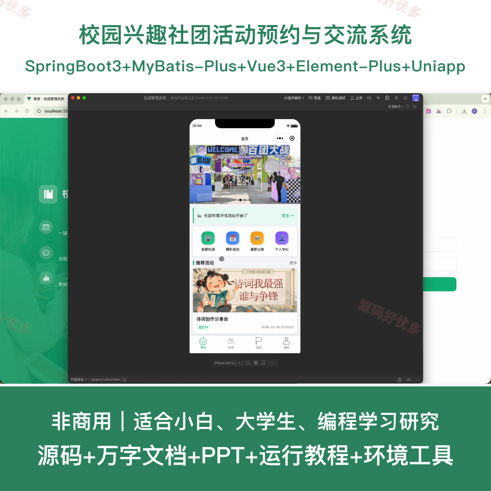
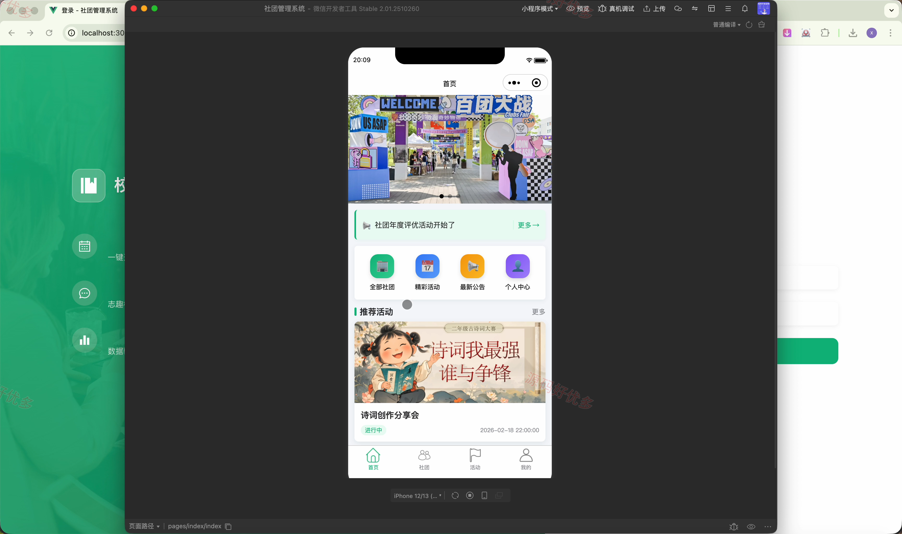
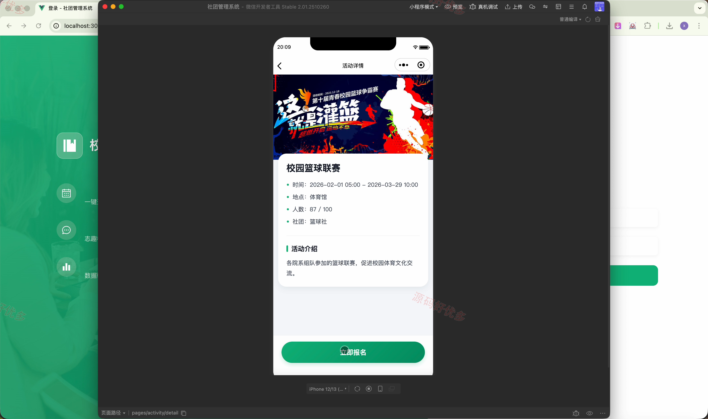
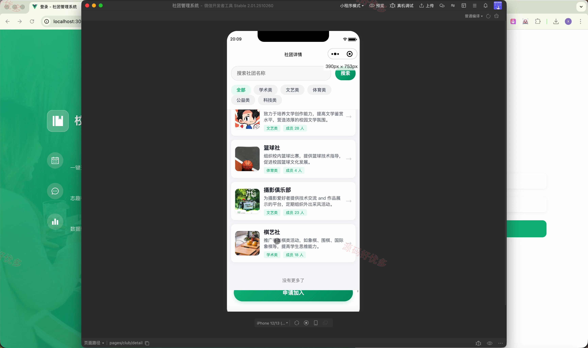
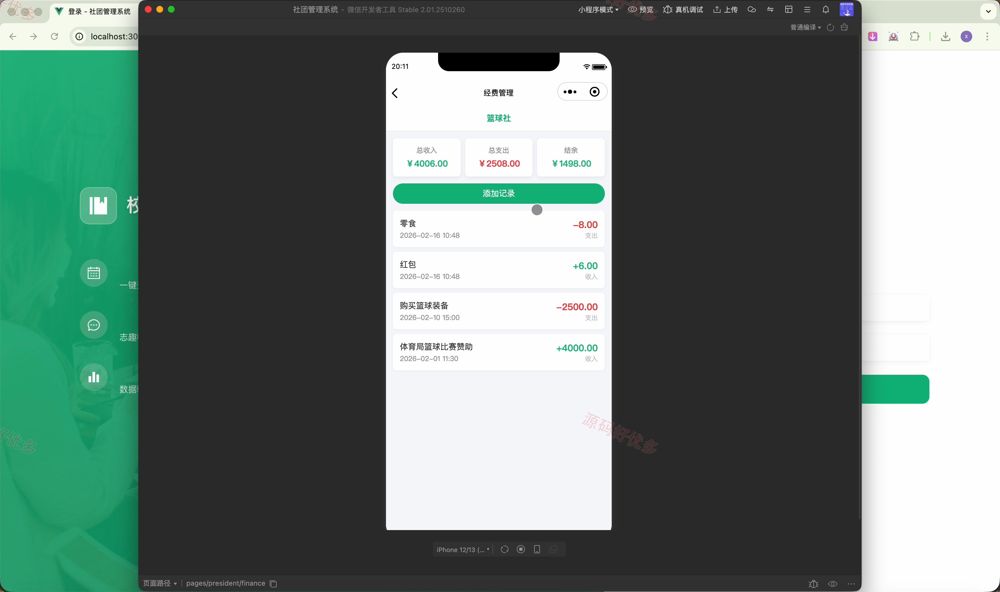
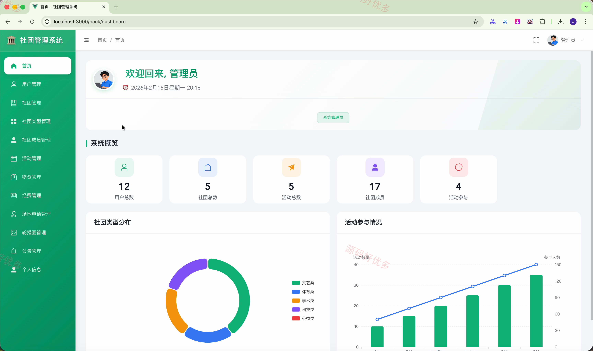
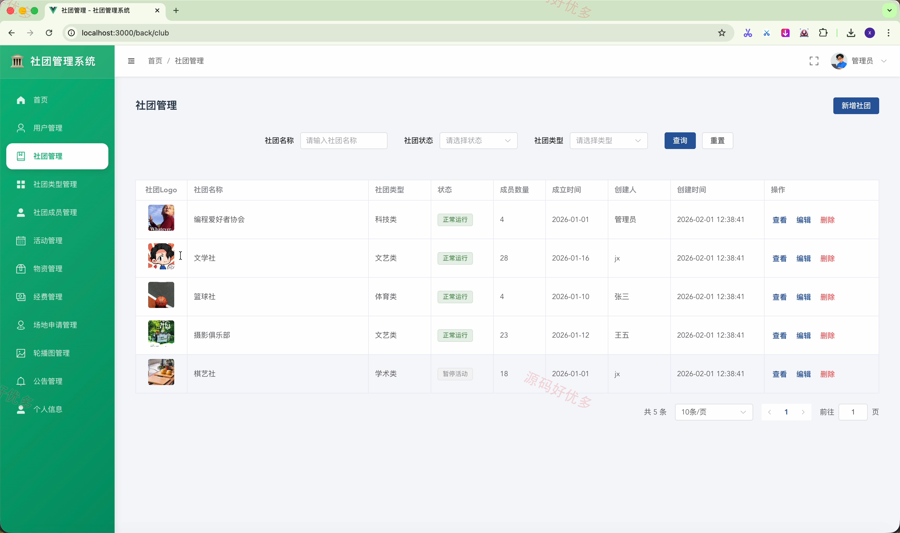
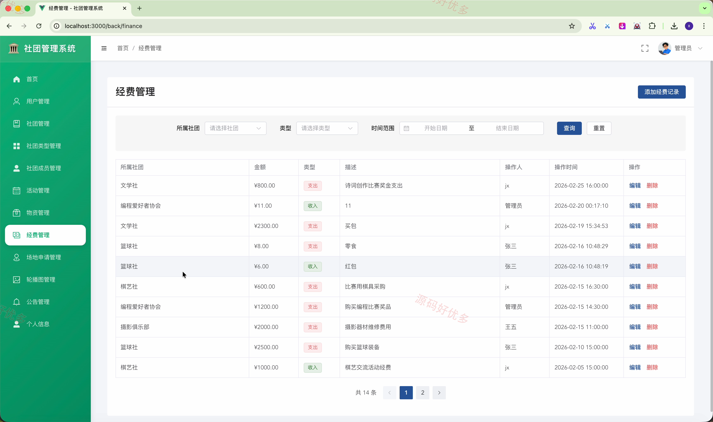
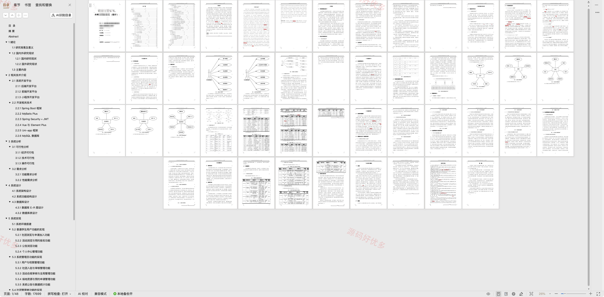

# mpweixinA284D
mpweixinA284D校园兴趣社团活动预约与交流系统源码前后分离小程序 Uniapp 设计文档 PPT
## 源码问题查看主页咨询

### 一、关键词
校园社团、学生社团活动、社团招新、活动报名、社团交流

### 二、作品包含
源码+数据库+万字设计文档+PPT+全套环境和工具资源+本地部署教程

### 三、项目技术
前端技术： Html、Css、Js、Vue3.2、Element-Plus、uniapp
后端技术：Java、SpringBoot3.2.0、MyBatis-Plus

### 四、运行环境要求
开发工具：IDEA/eclipse + VSCODE + HBuilder X + 微信开发者工具

数据库：MySQL8.0（共14张表）

数据库管理工具：Navicat10以上版本

环境配置软件： JDK17 + Maven3.6.3

前端Nodejs：20

浏览器：谷歌浏览器

### 五、项目介绍
项目编号：mpweixinA284D

系统面向校园社团管理员和学生用户，提供社团展示、入团申请、活动发布与报名、社团交流及公告浏览；社长可在授权后管理本社团成员、活动、经费、物资和场地申请。

角色：用户、管理员

用户功能：浏览社团与活动、申请加入社团、报名及查看我的活动、社团交流、查看公告、维护个人资料与密码、担任社长后审核成员及发布活动、担任社长后管理经费物资与场地申请。

管理员功能：用户管理、社团与类型管理、成员申请审核、活动与报名管理、物资管理、经费统计管理、场地申请管理、公告与轮播图管理。

### 六、运行截图

